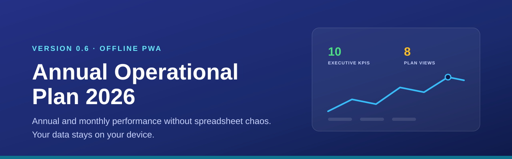
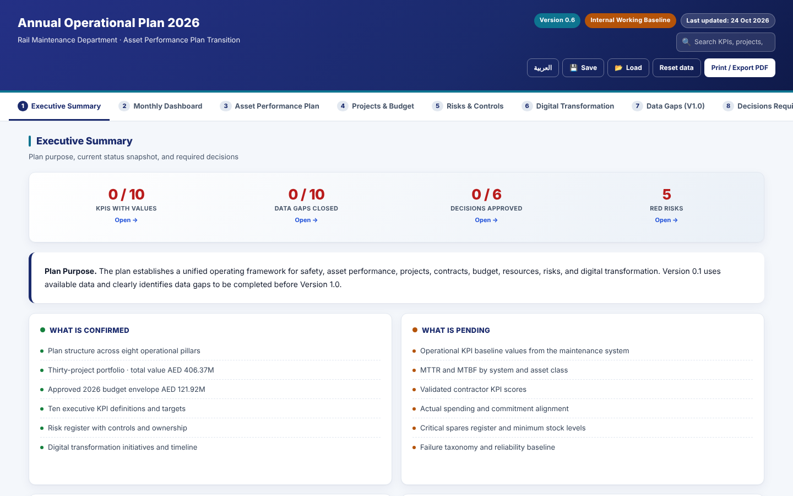
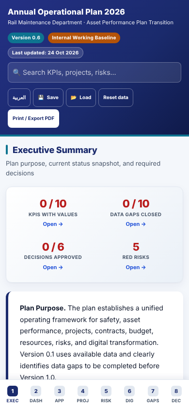
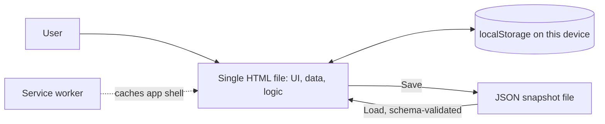

<p align="center"></p>

# Annual Operational Plan 2026

A single-file, offline executive dashboard for annual targets, monthly KPI reviews, risks and management decisions. No backend, no telemetry: your data stays in your browser.


## Overview

Single-file client-side executive dashboard. Zero dependencies at runtime, zero backend, zero telemetry. Everything persists to `localStorage` on the user's own device; nothing is transmitted. The interface is bilingual (English and Arabic with RTL layout).

### Product authority

| | |
|---|---|
| **Primary User** | Department director / planning lead |
| **Job To Be Done** | Manage annual & monthly performance without Excel chaos |
| **System of Record** | Targets, KPIs, monthly reviews, management actions |
| **System of Intelligence** | Deterministic trend alerts, traffic-light status |
| **Explicit Non-Goals** | Invoice validation engine (displays VERTEX results only) · task management (→ ExecFlow) · SaaS rewrite , the core stays offline |

## Key features

- **Eight plan views**: Executive Summary, Monthly Dashboard, Asset Performance Plan, Projects and Budget, Risks and Controls, Digital Transformation, Data Gaps and Decisions Required.
- **Executive status tiles** for KPIs with values, data gaps closed, decisions approved and red risks. Each tile opens the view that holds its detail; the red-risk tile opens the risk register filtered to Red.
- **Live KPI entry** with monthly history, sparklines, deterministic traffic-light status and notes.
- **Custom KPIs** (create, update, delete), global search, project and risk filters, risk heatmap.
- **CSV export** for KPIs, projects, risks and data gaps; **Print / Export PDF** with a cover page.
- **Save / Load** a JSON snapshot to move data between devices. Imports are validated against a strict schema.
- **Installable PWA**: manifest, service worker and icons; works offline after the first visit.
- **Accessibility**: keyboard-operable actions, focus kept inside dialogs, audited with axe-core.

## Screenshots

Captured from the static package (`npm run build`, served from `dist/`) with an empty browser profile.

| Desktop (1440 x 900) | Mobile (390 x 844) |
|---|---|
|  |  |

## Quick start

Open `Annual_Operational_Plan_2026_V0_6.html` in any modern browser. That is the whole app.

To serve the static package locally:

```bash
npm ci
npm run build                     # writes dist/
python3 -m http.server -d dist 8080
# open http://localhost:8080/Annual_Operational_Plan_2026_V0_6.html
```

## Scripts

| Script | Purpose |
|---|---|
| `npm test` | Release-pin agreement check plus Node state regressions (`tests/state.test.cjs`) |
| `npm run build` | Build `dist/` from an explicit allowlist of application files, with `release.json` hashes |
| `npm run test:browser` | Playwright acceptance: CRUD, persistence, backup round-trip, AR/EN dialogs, offline reload |
| `npm run test:audit` | Ten-suite audit (axe-core, responsive, keyboard, PWA, print, RTL); fails on P0 or P1 findings |

## Current release

**V0.6** , `Annual_Operational_Plan_2026_V0_6.html` (~160 KB).

Older versions are preserved alongside as historical references:

| File | Notes |
|---|---|
| `Annual_Operational_Plan_2026_V0_1.html` | Static seed, no interactivity |
| `Annual_Operational_Plan_2026_V0_2.html` | Live KPI entry + localStorage |
| `Annual_Operational_Plan_2026_V0_3.html` | Monthly history + sparklines + CSV export + deep-link tabs |
| `Annual_Operational_Plan_2026_V0_4.html` | Mobile-first + PWA + custom KPIs + global search + chart annotations + print cover page |
| `Annual_Operational_Plan_2026_V0_5.html` | Post-audit accessibility fixes (0 WCAG 2.2 AA violations) |
| **`Annual_Operational_Plan_2026_V0_6.html`** | Post-Lighthouse perf + hardening (this release) |

## What V0.6 adds on top of V0.5

- **CLS 0.49 → target ~0**: KPI cards reserve a fixed `min-height` and
  the sparkline slot always occupies its 40 px, so late-rendering content
  no longer shifts the layout.
- **`errors-in-console` fix**: favicon link added , no more 404 for
  `/favicon.ico`.
- **Heading order fix**: section titles are proper `<h2>`, card headings
  are `<h3>`. Skipped-level warnings gone.
- **localStorage quota resilience**: `saveState()` catches
  `QuotaExceededError`, surfaces a bilingual toast, and logs a warning
  telling the user to Save the snapshot to a file instead.
- **Snapshot import schema validation**: uploaded JSON is validated
  against a strict shape before it can populate state. Invalid files are
  rejected with a descriptive toast (e.g. `customKPIs: exceeds 200
  entries`) instead of loading silently.
- **Deployment configs**: `_headers` (Netlify), `netlify.toml`,
  `vercel.json` , ship-ready CSP, security headers, correct manifest
  MIME type, and `/` → current-release rewrite.

## Project structure

```text
Annual_Operational_Plan_2026_V0_{1..6}.html   release chain (V0.6 is current)
index.html                                    redirect to the current release
manifest.webmanifest, sw.js, icon-*.svg       PWA manifest, service worker, icons
scripts/build-static.mjs                      static package builder (dist/)
scripts/check-current-release.mjs             all host configs must pin the newest release
tests/                                        Node state tests, browser smoke, audit
vercel.json, netlify.toml, _headers           host configs with CSP and security headers
.github/workflows/                            CI and GitHub Pages deploy
DEPLOY.md, RELEASE_READINESS.md, AUDIT_V0_4.md, CHANGELOG.md
docs/assets/                                  README banner and screenshots
```

## Architecture



There is no server component. The service worker only caches the app shell for offline use.

## Deploy on Vercel

`vercel.json` builds the allowlisted static package and serves it with the CSP and security headers. `/` rewrites to the current release.

| Setting | Value |
|---|---|
| Framework preset | Other |
| Root directory | `./` (repository root) |
| Build command | `npm run build` (set in `vercel.json`) |
| Output directory | `dist` (set in `vercel.json`) |
| Environment variables | none |

GitHub Pages (`.github/workflows/pages.yml`) and Netlify (`netlify.toml`, `_headers`) are also configured. See [DEPLOY.md](DEPLOY.md) for the Pages setup and backup contract. Historical audit scores in older documents are not evidence of a current live deployment.

## Using the app

### As a downloaded file (offline, single-user)

1. Download `Annual_Operational_Plan_2026_V0_6.html`.
2. Open it in any modern browser (Chrome, Edge, Safari, Firefox).
3. Enter KPI values, notes, decision statuses. Everything saves to your
   browser's `localStorage`.
4. Use the **Save** button in the header to export the current state as
   a JSON snapshot. Use **Load** on another device to import it.

### As a hosted app (Android install support, multi-device link)

Any static host works. Netlify or Vercel deploy in one click.

**Netlify:**
```bash
# From the repository root:
npx netlify deploy --prod --dir .
```

**Vercel:**
```bash
# From the repository root:
npx vercel --prod
```

**GitHub Pages:** use Settings → Pages → Source: GitHub Actions. See [DEPLOY.md](DEPLOY.md) for the tested static-package workflow and one-time setup.

Once hosted over HTTPS, Chrome on Android automatically detects the
manifest + service worker + icons and offers an "Install" prompt. The
header's **Install app** button lights up when the browser makes the
`beforeinstallprompt` event available.

### On Android (installed as an app)

After installing from a hosted HTTPS URL:

- Home-screen icon opens the plan fullscreen (no browser UI).
- App-shell is cached by `sw.js`, so the plan works offline.
- Data persists in the browser's `localStorage` for that origin.
- **Sync between devices** , use the Save/Load buttons to move a JSON
  snapshot between devices; there is no server-side account.

## Reproducing the checks

```sh
npm ci
npx playwright install --with-deps chromium
npm test
npm run build
npm run test:browser
npm run test:audit
```

Node-only regressions cover persistence, legacy migration, deletion, invalid
snapshots and keyboard-control markup. Browser acceptance covers custom KPI
create/update/delete, save/reload, exported JSON restore in a fresh context,
invalid-import preservation, Arabic/English accessibility including dialogs,
and offline reload/edit/save under a repository subpath. The original ten-suite
audit also runs with local pinned dependencies. CI rejects P0 or P1 findings.

The 2026-10-23 hardening fixes prevent deleted final-month values resurfacing,
validate nested snapshot data before rendering, make decision/gap actions
keyboard-operable, label dialog controls and retain focus within dialogs.
Service-worker cache cleanup is scoped to this application's cache names.
These changes do not add a server or telemetry. See [DEPLOY.md](DEPLOY.md) for
current hosting status verification and the backup contract. Historical audit
scores in older documents are not evidence of a current live deployment.

## Status and known limitations

- Single user per browser. There is no account, no server and no automatic sync; Save/Load moves a JSON backup.
- Clearing site data, private browsing, a new hostname or a new device starts with empty local data.
- The project and risk catalogue is a built-in, generic planning baseline, not a collaborative database.
- KPI values start empty. Seed content models rail-maintenance KPIs at an abstract level for illustration.

## Non-goals

This project does **not** call any AI model, does **not** have a
backend, does **not** collect analytics, and does **not** send data
anywhere. It is a client-only executive-dashboard document. If you need
cloud sync, multi-user editing, or LLM assistance, it needs a companion
service , not a rewrite of this file.

## Content safety

All content is deliberately generic. Zero references to any organisation,
city, or vendor across the HTML, service worker, manifest, or icons.
The seed data models rail-maintenance operational KPIs at abstract level
for illustration.

## Arabic summary

<div dir="rtl" lang="ar">

**الخطة التشغيلية السنوية 2026** لوحة تنفيذية في ملف واحد تعمل دون اتصال، لإدارة المستهدفات السنوية والمراجعات الشهرية لمؤشرات الأداء والمخاطر والقرارات الإدارية.

- لا يوجد خادم ولا تتبع، وتُحفظ جميع البيانات في متصفح المستخدم على جهازه فقط.
- واجهة ثنائية اللغة بالعربية والإنجليزية مع دعم الاتجاه من اليمين إلى اليسار.
- يمكن تثبيتها كتطبيق ويب تقدمي والعمل بها دون اتصال بعد الزيارة الأولى.
- يمكن حفظ نسخة من البيانات في ملف JSON واستعادتها على جهاز آخر، مع التحقق من صحة الملف قبل تحميله.

</div>

## Ownership

Owned and maintained by Ahmed Zaian. No license file is included; all rights reserved unless the owner states otherwise.
